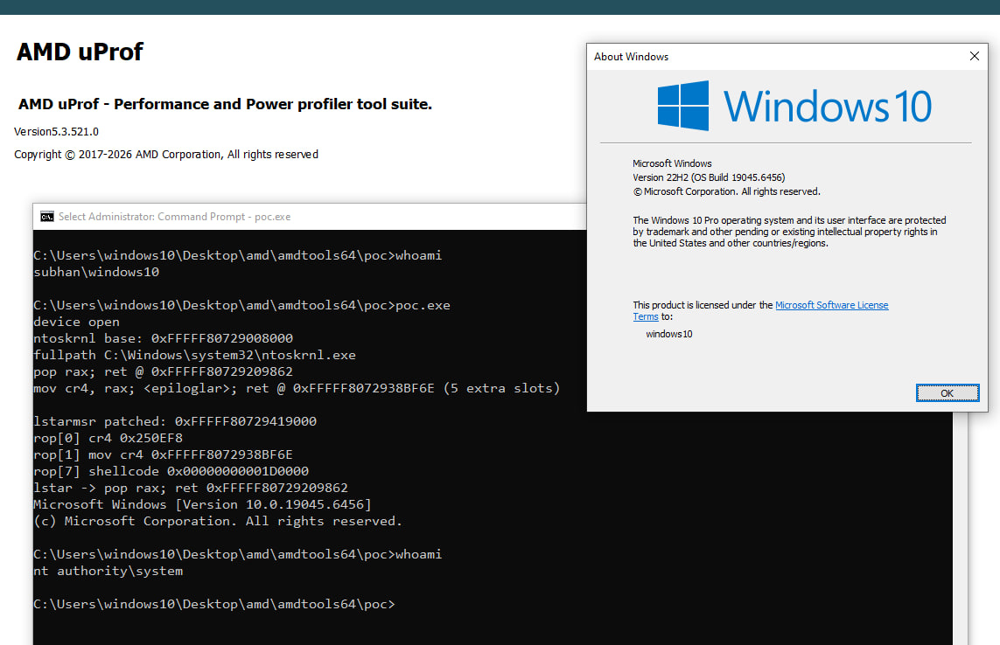

hi hackers.

AmdTools64.sys is the signed Special Tools driver that ships with AMD uProf. No UAC bypass, no standard-user boundary. Once you have the handle there is no whitelist on the MSR index, so you can read and write whatever MSR you like.

The read side already breaks KASLR by itself. Read `IA32_LSTAR` (`0xC0000082`) and the driver hands you `ntoskrnl!KiSystemCall64` for free. The write side is the real problem. `IA32_LSTAR` is the address the CPU jumps to on every syscall, and the driver lets a normal user overwrite it. Point it at code you control and the next syscall runs your code at CPL0. SMEP is the only thing in the way, so the exploit reads `IA32_LSTAR` first to find ntoskrnl, parses the import directory from disk, finds a couple of gadgets to clear SMEP with `mov cr4, rax`, runs a small shellcode that copies the SYSTEM token into the current process, and restores `IA32_LSTAR` on the way out so the machine keeps working.

There are two IOCTLs and that is the whole story. `0xFFF02804` reads an MSR and `0xFFF02808` writes one, both with a 20-byte buffer and no index validation. The dispatcher only checks the buffer lengths. There is also a physical-memory read/write and a user-mode physical map (`0xFFF0281C`, `0xFFF02820`, `0xFFF028A4`), but the map path can trip `PFN_LIST_CORRUPT` on arbitrary RAM, so the MSR path is the one used here.

I tested this on Windows 10 x64 22H2 (build 19045.6456) with AMD uProf 5.3.521.0. The driver is version 1.7.16.218. No race and no heap grooming, it worked every time I ran it. The driver ships with uProf and is installed on a lot of AMD machines, so it is already loaded for you. The screenshot is the Win10 box: `whoami` is `subhan\windows10` before, `nt authority\system` after.

On Windows 11 26300 I could install the driver and read `IA32_LSTAR`, but the `wrmsr` to LSTAR fails when Memory Integrity is on, VBS/HVCI intercepts it. The known Win11 EPROCESS layout is `UniqueProcessId 0x1D0`, `ActiveProcessLinks 0x1D8`, `Token 0x248`, `ImageFileName 0x338`, checked against `PsGetProcessId`, `PsReferenceProcessToken` and `PsGetProcessImageFileName` in that build.

The value is the signed driver and the kernel primitive: an administrator can load the AMD driver and get ring-0 code execution. The LSTAR-to-SYSTEM chain here is the exploit part, not a new driver discovery.

I reported it to AMD PSIRT on 2026-08-17. However, they did everything in their power to avoid acknowledging this gap they even blocked me on Gmail so that I couldn't send them emails from my own address anymore. This is just the beginning; moving forward, I won't be sharing my findings regarding AMD products with them directly or through their other channels. I will continue to share everything right here. Stay tuned, and keep hacking!
